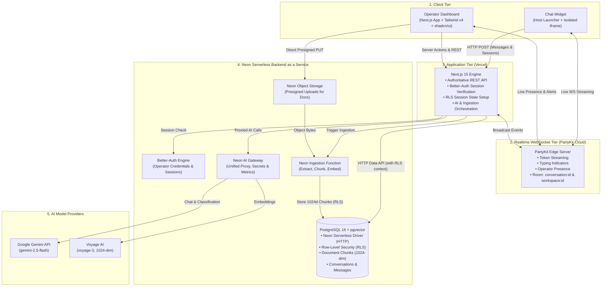
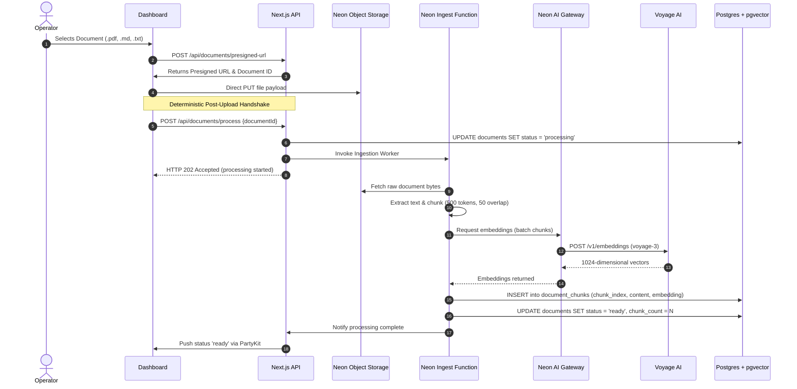
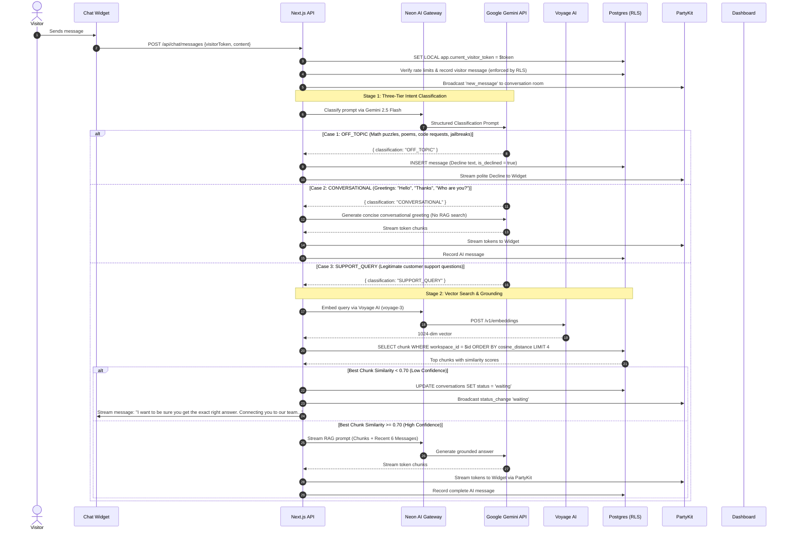
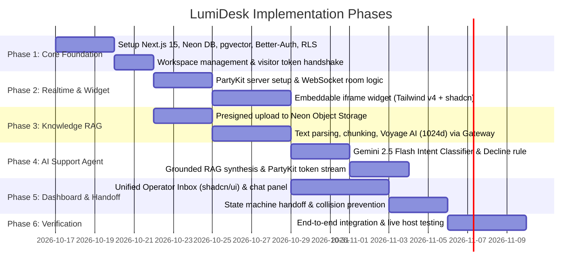

# Product Requirements Document (PRD)

# LumiDesk: Real-Time Live Support Platform & Guarded AI Agent

| Metadata | Details |
| :--- | :--- |
| **Product Name** | LumiDesk |
| **Document Version** | 1.2 (Complete Architecture & Technical Stack Specification) |
| **Status** | Approved for Implementation |
| **Target Milestone** | v1.0 Production MVP |
| **Author** | Product & Engineering Team |
| **Domain Glossary** | [GLOSSARY.md](./GLOSSARY.md) |
| **Architectural Decisions** | [ADR 0001](./docs/adr/0001-nextjs-authoritative-api-partykit-relay.md), [ADR 0002](./docs/adr/0002-three-tier-intent-classification.md), [ADR 0003](./docs/adr/0003-voyage-ai-embeddings-gemini-chat.md), [ADR 0004](./docs/adr/0004-neon-data-api-and-rls-over-orm.md), [ADR 0005](./docs/adr/0005-dual-rls-and-neon-ai-gateway.md) |

---

## 1. Executive Summary & Problem Framing

### 1.1 The Problem
Customer support for fast-moving web businesses is trapped in an unsustainable trade-off:
1. **24/7 Human Coverage is Cost-Prohibitive:** Small and mid-sized teams cannot maintain around-the-clock shift coverage, causing high-intent prospects and paying customers in different time zones to abandon sites due to delayed replies.
2. **Unguarded Chatbots Create Brand & Financial Liability:** Conventional generative bots hallucinate answers when ungrounded, lack boundaries, and happily write poems or solve math riddles. Every irrelevant question answered is an attack surface, an invitation for jailbreaking, and burned LLM token costs.
3. **Abrupt Dead Ends:** When automated bots cannot answer, they leave visitors stranded with no real-time transition to an actual team member monitoring the desk.

### 1.2 The Solution
**LumiDesk** is a focused, Intercom-style real-time customer support platform designed around three pillars:
* **Frictionless Live Chat:** A tiny embeddable script launching an isolated iframe chat widget on any website, styled with Tailwind CSS v4 and shadcn/ui, connected via real-time WebSockets to a collaborative Operator dashboard.
* **Guarded AI Support Agent:** A retrieval-augmented generation (RAG) agent answering visitor queries *strictly* from uploaded company documents (PDFs, Markdown, plain text). Embeddings are powered by **Voyage AI (`voyage-3`, 1024-dim)** for high-precision retrieval, and inference is powered by **Google Gemini API (`gemini-2.5-flash`)** proxied via the Neon AI Gateway, backed by a mandatory front-door intent classifier that politely declines off-topic prompts before vector search occurs.
* **Instant Operator Handoff:** A deterministic conversation state machine that silences the AI Agent and alerts human Operators the instant confidence drops or a visitor asks for human help.

---

## 2. Product Principles & Boundaries

### 2.1 Core Principles
1. **Grounded Over Generative:** The AI Agent never invents facts. If information is not in the uploaded Documents, the agent states its limits and initiates a Handoff.
2. **Defend the Perimeter:** Every incoming message is screened before retrieval. Irrelevant prompts are intercepted immediately to eliminate token waste and model misuse.
3. **Zero-Drop Resilience:** Real-time WebSockets provide speed, but PostgreSQL via the Neon Data API is the authoritative ledger. No message or state change is lost during reconnects or tab closures.
4. **Defense in Depth with RLS:** Row-Level Security (RLS) enforced at the database tier mathematically ensures tenant and visitor isolation, replacing heavy ORMs with direct, secure SQL queries.
5. **Zero Host Interference:** The client-side widget runs inside a sandboxed iframe to guarantee zero CSS or JavaScript collisions with host websites.

### 2.2 Scope Boundaries (The v1 Perimeter)

```
┌─────────────────────────────────────────────────────────────┐
│                    IN SCOPE (v1 MVP)                        │
├─────────────────────────────────────────────────────────────┤
│ • Embeddable launcher + iframe widget with anonymous tokens │
│ • Tailwind CSS v4 + shadcn/ui design system                 │
│ • Collaborative multi-operator web dashboard & unified inbox│
│ • Knowledge Base: Presigned upload, chunking, pgvector RAG  │
│ • Voyage AI (voyage-3, 1024d) high-precision vector search  │
│ • Google Gemini API (gemini-2.5-flash) via Neon AI Gateway  │
│ • Neon Serverless Driver (HTTP Data API) + PostgreSQL RLS   │
│ • 3-Tier Intent Classifier (Support vs Conversational vs Off)│
│ • State machine: ai_answering → waiting → human → closed    │
│ • PartyKit real-time WebSockets (streaming tokens, presence)│
│ • Workspace multi-tenancy & Better-Auth team authentication │
└─────────────────────────────────────────────────────────────┘
                              │
                              ▼
┌─────────────────────────────────────────────────────────────┐
│                 EXPLICIT NON-GOALS (v1)                     │
├─────────────────────────────────────────────────────────────┤
│ ✕ No Email Ticketing or omnichannel piping (SMS, WhatsApp)  │
│ ✕ No Public Help Center or self-serve article portal        │
│ ✕ No Product Tours, onboarding tooltips, or popup campaigns │
│ ✕ No Native Mobile Applications (iOS / Android)             │
│ ✕ No Billing, Stripe checkout, or subscription management   │
└─────────────────────────────────────────────────────────────┘
```

---

## 3. Technology Stack Specification

| Layer | Selected Technology | Architecture & Implementation Details |
| :--- | :--- | :--- |
| **Framework & Engine** | **Next.js 15 (App Router)** | Full-stack React 19 framework deployed to **Vercel**; handles server components, Route Handlers, and server actions. |
| **UI & Design System** | **Tailwind CSS v4 + shadcn/ui** | Tailwind v4 with native CSS `@theme` variables, Radix Primitives via shadcn/ui for accessible, sleek dark mode components. |
| **Real-Time Engine** | **PartyKit Cloud** | Edge WebSocket servers providing sub-50ms message broadcasting, typing indicators, operator presence, and token streaming. |
| **Backend as a Service** | **Neon** | Comprehensive serverless PostgreSQL platform: |
| — *Data Access* | **Neon Data API** | Direct SQL execution over HTTP via `@neondatabase/serverless`; no heavyweight ORM (Prisma/Drizzle) required. |
| — *Security* | **PostgreSQL RLS** | Row-Level Security policies enforcing tenant workspace isolation and visitor conversation boundaries. |
| — *Vector Search* | **PostgreSQL + pgvector** | Native vector storage indexing 1024-dimensional embeddings with IVFFlat cosine similarity. |
| — *Authentication* | **Better-Auth** | Neon-managed authentication for Operator accounts, session tokens, and workspace membership. |
| — *Object Storage* | **Neon Object Storage** | S3-compatible storage with presigned PUT URLs for direct, secure document uploads (PDF, Markdown, TXT). |
| — *Background Workers* | **Neon Functions** | Serverless functions for document parsing, semantic chunking, and embedding generation triggered post-upload. |
| — *AI Proxy* | **Neon AI Gateway** | Centralized proxy managing provider secrets, request retries, token usage metrics, and model caching. |
| **Specialized AI** | **Voyage AI + Google Gemini** | |
| — *Text Embeddings* | **Voyage AI (`voyage-3`)** | 1024-dimensional embeddings optimized for technical and domain-specific document retrieval. |
| — *Chat & Classification* | **Google Gemini (`gemini-2.5-flash`)** | Ultra-low latency LLM for Stage 1 Three-Tier Classification and Stage 2 Grounded RAG answer generation. |

---

## 4. System Architecture & Topology



---

## 5. Detailed Operational Flows

### Flow A: Knowledge Ingestion & Vector Pipeline


---

### Flow B: Visitor Message, Three-Tier Classification & RAG Answer


---

### Flow C: Conversation Lifecycle & Operator Handoff

```mermaid
stateDiagram-v2
    [*] --> ai_answering: Visitor sends first message

    state ai_answering {
        [*] --> Evaluating
        Evaluating --> Responding: High-confidence RAG answer
        Evaluating --> Declining: Off-topic classified
    }

    ai_answering --> waiting: Low confidence (< 0.70) OR Visitor requests human
    ai_answering --> closed: Conversation concluded

    state waiting {
        note right of waiting
            • AI Agent is strictly muted
            • Widget displays: 'Connecting to team...'
            • Dashboard displays high-priority badge
        end note
    }

    waiting --> human: Operator views chat & sends reply
    waiting --> closed: Operator marks resolved or visitor abandons

    state human {
        note right of human
            • AI Agent is permanently silenced
            • Direct live messaging between Visitor & Operator
            • Presence indicators active
        end note
    }

    human --> waiting: Operator re-queues conversation
    human --> closed: Operator marks resolved

    closed --> ai_answering: Visitor sends new message (re-opens thread)
```

---

## 6. Database Schema & Row-Level Security (RLS)

All tables run on **Neon PostgreSQL** with native `pgvector` indexing. Row-Level Security (RLS) is enabled on all multi-tenant tables.

```sql
-- Extensions
CREATE EXTENSION IF NOT EXISTS "uuid-ossp";
CREATE EXTENSION IF NOT EXISTS "vector";

-- 1. Workspaces (Tenant Container)
CREATE TABLE workspaces (
    id UUID PRIMARY KEY DEFAULT uuid_generate_v4(),
    name VARCHAR(255) NOT NULL,
    widget_key VARCHAR(64) UNIQUE NOT NULL,
    created_at TIMESTAMP WITH TIME ZONE DEFAULT NOW(),
    updated_at TIMESTAMP WITH TIME ZONE DEFAULT NOW()
);
CREATE INDEX idx_workspaces_widget_key ON workspaces(widget_key);

-- 2. Users (Operators & Owners via Better-Auth)
CREATE TABLE users (
    id UUID PRIMARY KEY DEFAULT uuid_generate_v4(),
    workspace_id UUID NOT NULL REFERENCES workspaces(id) ON DELETE CASCADE,
    email VARCHAR(255) UNIQUE NOT NULL,
    name VARCHAR(255) NOT NULL,
    role VARCHAR(32) DEFAULT 'operator' CHECK (role IN ('owner', 'operator')),
    avatar_url TEXT,
    created_at TIMESTAMP WITH TIME ZONE DEFAULT NOW()
);
CREATE INDEX idx_users_workspace ON users(workspace_id);

-- 3. Documents (Uploaded Knowledge Files)
CREATE TABLE documents (
    id UUID PRIMARY KEY DEFAULT uuid_generate_v4(),
    workspace_id UUID NOT NULL REFERENCES workspaces(id) ON DELETE CASCADE,
    filename VARCHAR(255) NOT NULL,
    storage_path TEXT NOT NULL,
    file_type VARCHAR(32) NOT NULL,
    file_size_bytes INT NOT NULL,
    status VARCHAR(32) DEFAULT 'pending' CHECK (status IN ('pending', 'processing', 'ready', 'failed')),
    chunk_count INT DEFAULT 0,
    created_at TIMESTAMP WITH TIME ZONE DEFAULT NOW()
);
CREATE INDEX idx_documents_workspace_status ON documents(workspace_id, status);

-- 4. Document Chunks (Voyage AI Vector Store)
CREATE TABLE document_chunks (
    id UUID PRIMARY KEY DEFAULT uuid_generate_v4(),
    workspace_id UUID NOT NULL REFERENCES workspaces(id) ON DELETE CASCADE,
    document_id UUID NOT NULL REFERENCES documents(id) ON DELETE CASCADE,
    chunk_index INT NOT NULL,
    content TEXT NOT NULL,
    embedding VECTOR(1024) NOT NULL, -- Voyage AI voyage-3 embedding (1024 dimensions)
    created_at TIMESTAMP WITH TIME ZONE DEFAULT NOW()
);
CREATE INDEX idx_document_chunks_workspace ON document_chunks(workspace_id);
CREATE INDEX idx_document_chunks_vector ON document_chunks USING ivfflat (embedding vector_cosine_ops) WITH (lists = 100);

-- 5. Visitors (End-users on host websites)
CREATE TABLE visitors (
    id UUID PRIMARY KEY DEFAULT uuid_generate_v4(),
    workspace_id UUID NOT NULL REFERENCES workspaces(id) ON DELETE CASCADE,
    visitor_token VARCHAR(128) UNIQUE NOT NULL,
    name VARCHAR(255),
    email VARCHAR(255),
    ip_hash VARCHAR(64),
    user_agent TEXT,
    created_at TIMESTAMP WITH TIME ZONE DEFAULT NOW(),
    last_seen_at TIMESTAMP WITH TIME ZONE DEFAULT NOW()
);
CREATE INDEX idx_visitors_lookup ON visitors(workspace_id, visitor_token);

-- 6. Conversations (Lifecycle Container)
CREATE TABLE conversations (
    id UUID PRIMARY KEY DEFAULT uuid_generate_v4(),
    workspace_id UUID NOT NULL REFERENCES workspaces(id) ON DELETE CASCADE,
    visitor_id UUID NOT NULL REFERENCES visitors(id) ON DELETE CASCADE,
    assigned_operator_id UUID REFERENCES users(id) ON DELETE SET NULL,
    status VARCHAR(32) DEFAULT 'ai_answering' CHECK (status IN ('ai_answering', 'waiting', 'human', 'closed')),
    last_message_at TIMESTAMP WITH TIME ZONE DEFAULT NOW(),
    created_at TIMESTAMP WITH TIME ZONE DEFAULT NOW()
);
CREATE INDEX idx_conversations_workspace_status ON conversations(workspace_id, status, last_message_at DESC);

-- 7. Messages (Individual Chat Turns)
CREATE TABLE messages (
    id UUID PRIMARY KEY DEFAULT uuid_generate_v4(),
    conversation_id UUID NOT NULL REFERENCES conversations(id) ON DELETE CASCADE,
    sender_type VARCHAR(16) NOT NULL CHECK (sender_type IN ('visitor', 'ai', 'operator')),
    sender_id UUID, -- NULL for visitor and AI, user_id for operator
    content TEXT NOT NULL,
    is_declined BOOLEAN DEFAULT FALSE,
    created_at TIMESTAMP WITH TIME ZONE DEFAULT NOW()
);
CREATE INDEX idx_messages_conversation_created ON messages(conversation_id, created_at ASC);

-- =========================================================================
-- ROW-LEVEL SECURITY (RLS) POLICIES
-- =========================================================================

-- Enable RLS on core tables
ALTER TABLE workspaces ENABLE ROW LEVEL SECURITY;
ALTER TABLE users ENABLE ROW LEVEL SECURITY;
ALTER TABLE documents ENABLE ROW LEVEL SECURITY;
ALTER TABLE document_chunks ENABLE ROW LEVEL SECURITY;
ALTER TABLE visitors ENABLE ROW LEVEL SECURITY;
ALTER TABLE conversations ENABLE ROW LEVEL SECURITY;
ALTER TABLE messages ENABLE ROW LEVEL SECURITY;

-- Helper functions to read session variables set by Next.js
CREATE OR REPLACE FUNCTION current_app_workspace_id() RETURNS UUID AS $$
    SELECT NULLIF(current_setting('app.current_workspace_id', true), '')::UUID;
$$ LANGUAGE SQL STABLE;

CREATE OR REPLACE FUNCTION current_app_visitor_token() RETURNS TEXT AS $$
    SELECT NULLIF(current_setting('app.current_visitor_token', true), '');
$$ LANGUAGE SQL STABLE;

-- 1. Operator Policies (Workspace Scoped)
CREATE POLICY operator_documents_policy ON documents
    FOR ALL USING (workspace_id = current_app_workspace_id());

CREATE POLICY operator_document_chunks_policy ON document_chunks
    FOR ALL USING (workspace_id = current_app_workspace_id());

CREATE POLICY operator_conversations_policy ON conversations
    FOR ALL USING (workspace_id = current_app_workspace_id());

CREATE POLICY operator_messages_policy ON messages
    FOR ALL USING (
        EXISTS (
            SELECT 1 FROM conversations c
            WHERE c.id = messages.conversation_id
            AND c.workspace_id = current_app_workspace_id()
        )
    );

-- 2. Visitor Policies (Conversation Scoped via visitor_token)
CREATE POLICY visitor_conversations_policy ON conversations
    FOR ALL USING (
        EXISTS (
            SELECT 1 FROM visitors v
            WHERE v.id = conversations.visitor_id
            AND v.visitor_token = current_app_visitor_token()
        )
    );

CREATE POLICY visitor_messages_policy ON messages
    FOR ALL USING (
        EXISTS (
            SELECT 1 FROM conversations c
            JOIN visitors v ON v.id = c.visitor_id
            WHERE c.id = messages.conversation_id
            AND v.visitor_token = current_app_visitor_token()
        )
    );
```

---

## 7. Real-Time WebSocket Architecture (PartyKit)

PartyKit isolates WebSocket connections into scoped rooms with token authentication:

| Room Pattern | Target Audience | Authentication Mechanism | Events Broadcast |
| :--- | :--- | :--- | :--- |
| `conversation:{conversationId}` | Visitor + Assigned Operators | Signed JWT room token verifying `visitor_token` or Operator session | `new_message`, `token_stream`, `typing_indicator`, `status_change` |
| `workspace:{workspaceId}` | Authenticated Operators only | Verified Better-Auth session cookie | `inbox_updated`, `operator_presence`, `escalation_alert` |

### Key Event Specifications:
* `token_stream`: Incremental delta tokens streamed from Gemini 2.5 Flash to the widget.
* `status_change`: Instant notification when a chat moves to `waiting` or `human`.
* `operator_presence`: Broadcasts active operator viewing/typing state to prevent collision.

---

## 8. Functional Requirements Checklist

### 8.1 Embeddable Widget (`/widget`)
* **FR-1.1 Loader Script:** Lightweight `<script>` tag (`< 10KB`) injected into the host DOM.
* **FR-1.2 Style Isolation:** Rendered inside an `<iframe>` styled with Tailwind CSS v4 to guarantee 0% CSS conflict with the host website.
* **FR-1.3 Identity Handshake:** Generates and stores a random `visitor_token` in host `localStorage`.
* **FR-1.4 Live Streaming:** Connects to PartyKit `conversation:{id}` to stream Gemini tokens and operator replies.

### 8.2 Operator Dashboard (`/app`)
* **FR-2.1 Authentication:** Better-Auth login and session verification with role checks (`owner`, `operator`).
* **FR-2.2 Unified Inbox:** Split-pane inbox styled with shadcn/ui components:
  * Filter tabs: `All`, `Needs Attention (Waiting)`, `Assigned to Me`, `Closed`.
  * Dynamic live updates via PartyKit `workspace:{id}` channel without page reloads.
* **FR-2.3 1-Click Takeover:** "Take Over from AI" button sets `status = 'human'`, alerts the Visitor, and mutes the AI Agent.
* **FR-2.4 Knowledge Center:** Drag-and-drop file uploader supporting `.pdf`, `.md`, `.txt` with direct presigned uploads to Neon Object Storage.

### 8.3 Ingestion & Guarded AI Pipeline
* **FR-3.1 Deterministic Ingest Handshake:** Client issues `POST /api/documents/process` immediately after presigned upload completion to invoke the Neon Function.
* **FR-3.2 Semantic Chunking:** Ingest worker splits documents into 500-token chunks with 50-token overlap, calling Voyage AI (`voyage-3`) via the Neon AI Gateway for 1024-dim vectors.
* **FR-3.3 Stage 1 Intent Classifier:** Gemini 2.5 Flash categorizes input into `SUPPORT_QUERY`, `CONVERSATIONAL`, or `OFF_TOPIC`. Off-topic prompts return an immediate polite Decline.
* **FR-3.4 Stage 2 Grounded RAG:** Queries Voyage AI embeddings, searches `document_chunks` with `workspace_id` filter; if top similarity is $< 0.70$, initiates Handoff to `waiting`; if $\ge 0.70$, streams grounded generation via Gemini 2.5 Flash.

---

## 9. Phased Implementation Roadmap



### Phase Milestones
* **Milestone 1 (Foundations):** Multi-tenant schema, Neon PostgreSQL with `pgvector` (1024-dim), Better-Auth session login, Neon Data API client, and RLS policies.
* **Milestone 2 (Realtime Core):** PartyKit edge server running room isolation, iframe widget styled with Tailwind v4 + shadcn/ui.
* **Milestone 3 (Knowledge Base):** Presigned S3 uploads, background parsing, 500-token chunking, and Voyage AI `voyage-3` vector indexing via Neon AI Gateway.
* **Milestone 4 (Guarded AI Agent):** Gemini 2.5 Flash three-tier classification intercepting off-topic prompts, streaming grounded RAG responses to widget via PartyKit.
* **Milestone 5 (Operator Desk & Handoff):** Live collaborative inbox, presence indicators, 1-click takeover, and status state machine.
* **Milestone 6 (Production Polish):** End-to-end testing on an external live website, verification of rate limits, RLS security, and zero-drop delivery.
